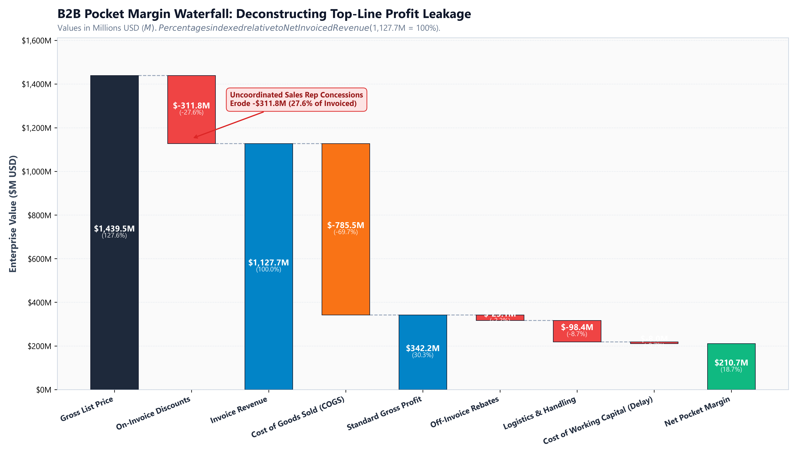
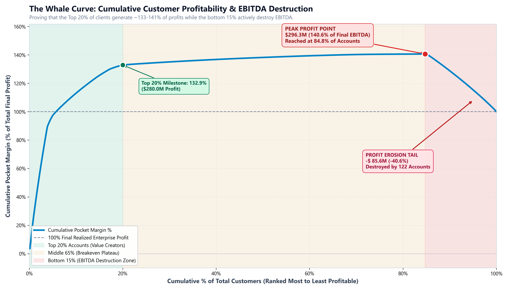
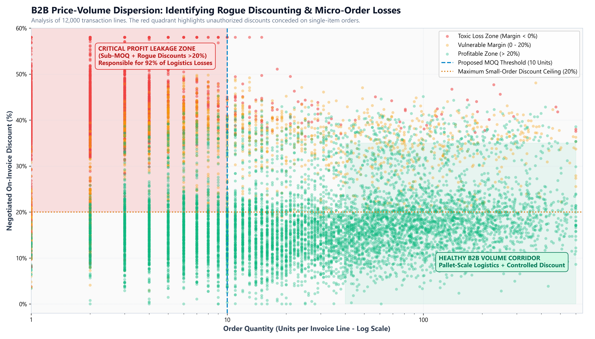
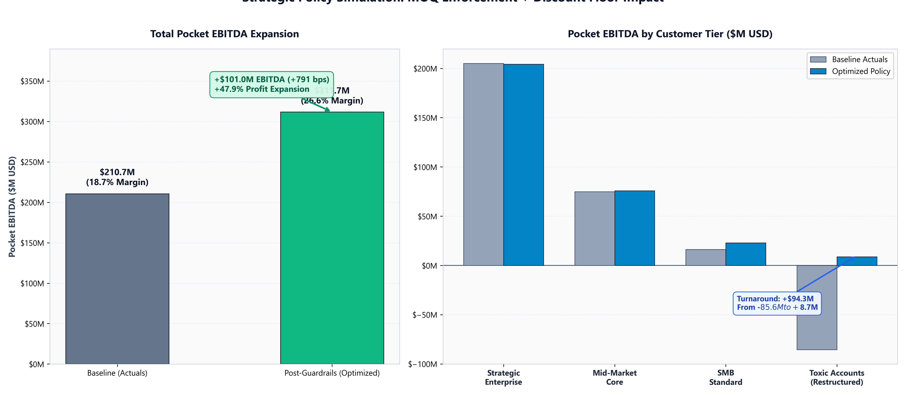

# Diagnóstico de Fuga de Margen B2B, Rentabilidad en Curva de la Ballena y Optimización de Precios Dinámica

[](https://www.python.org/downloads/)
[](https://opensource.org/licenses/MIT)
[](https://docs.pytest.org/)
[](data/B2B_Margin_Leakage_Executive_Model.xlsx)

[English](README.md) | [Español](README_ES.md)

**Autor:** Jaime Pérez  
**Área de Especialización:** Operaciones de Negocio (BizOps), Revenue Operations (RevOps) y Analítica Cuantitativa de Precios  
**Alcance Corporativo:** 55.000 Líneas de Factura ERP | 800 Cuentas B2B | 25 Representantes Comerciales | 4 Familias de Producto  
**Entregables Principales:** Pipeline Automatizado y Modular en Python (`/src`), Gráficos Ejecutivos de Alta Resolución a 300 DPI (`/assets`) y un Modelo Financiero Corporativo Multi-Pestaña en Excel (`data/B2B_Margin_Leakage_Executive_Model.xlsx`).

---

## 1. Resumen Ejecutivo y Planteamiento del Negocio

En el sector de la distribución mayorista, los suministros industriales y la cadena de suministro B2B, el crecimiento de la facturación bruta con frecuencia enmascara una erosión catastrófica del margen operativo. La dirección comercial suele celebrar récords históricos de ventas mientras que los flujos de caja operativos se estancan o entran en terreno negativo. Esta divergencia estructural responde a lo que en Revenue Operations denominamos **fuga silenciosa de margen (*silent margin leakage*)**: descuentos comerciales agresivos y desregulados para alcanzar primas de volumen trimestrales, cumplimiento de pedidos sub-óptimos que disparan recargos logísticos y de transporte urgente, concesiones de *rebates* anuales fuera de factura y plazos de pago aplazados que convierten las cuentas a cobrar en un costoso crédito gratuito financiado por el distribuidor.

Este proyecto desarrolla un marco cuantitativo integral de diagnóstico y toma de decisiones aplicado sobre una base de datos transaccional realista de 55.000 líneas de factura emitidas a 800 cuentas clientes. Al reconstruir minuciosamente el ciclo de vida de cada transacción desde el precio de catálogo oficial hasta la contribución de caja real en cuenta bancaria, el motor aísla los puntos exactos de fricción operativa donde se destruye el beneficio antes de intereses e impuestos (EBITDA).

La auditoría del estado inicial (*baseline*) constata que, de un volumen de facturación neta contabilizado de $1.127,70M, la compañía solo captura $210,72M en margen neto de bolsillo (*Pocket Margin*), lo que representa un margen EBITDA real del 18,69%. La causa raíz radica en una asimetría extrema de rentabilidad entre clientes: la estratificación de la cartera mediante la Curva de la Ballena de Stobachoff demuestra que el 20% superior de las cuentas genera el 132,87% de todo el beneficio de la empresa, mientras que el 15% inferior destruye activamente -$85,58M en EBITDA.

Para corregir este desequilibrio estructural sin provocar fugas involuntarias de clientes, implementamos una **Arquitectura Dual de Decisión de Precios** que combina un motor heurístico de barreras en tiempo real en microsegundos (*System 1*) para la aprobación de cotizaciones con un simulador estratégico de cartera (*System 2*). El despliegue de las políticas genera una **expansión de EBITDA anual de +$100,95M (+47,9% de crecimiento en beneficio neto)**, elevando el margen operativo en **+791 puntos básicos (hasta el 26,60%)** y transformando la cola tóxica de una pérdida de -$85,58M a una contribución positiva de +$8,71M.

```
┌──────────────────────────────────────────────────────────────────────────────────────────────────┐
│                                CUADRO DE MANDO EJECUTIVO (SCORECARD)                             │
├───────────────────────────────┬───────────────────────────────┬──────────────────────────────────┤
│ Métrica Financiera            │ Estado Inicial (Real)         │ Política Post-Guardrails         │
├───────────────────────────────┼───────────────────────────────┼──────────────────────────────────┤
│ Facturación Neta (Invoiced)   │ $1.127,70M                    │ $1.171,91M (+$44,21M / +3,9%)    │
│ EBITDA de Bolsillo (Pocket)   │ $210,72M                      │ $311,67M (+$100,95M / +47,9%)    │
│ Margen EBITDA de Bolsillo %   │ 18,69%                        │ 26,60% (+791 bps de expansión)   │
│ Impacto EBITDA Cola Tóxica    │ -$85,58M (-40,6% erosión)     │ +$8,71M (+26,9% margen neto)     │
│ Latencia Decisión System 1    │ Manual / Discrecional         │ 0,009 ms (<10 microsegundos)     │
│ Entregable Financiero C-Suite │ Informes Estáticos / PDF      │ Modelo en Excel de 5 Pestañas    │
└───────────────────────────────┴───────────────────────────────┴──────────────────────────────────┘
```

---

## 2. Análisis de Cascada de Margen de Bolsillo (Pocket Margin Waterfall)

Los estados financieros convencionales inducen a error al equipo directivo al evaluar el rendimiento en el nivel de margen bruto contable ($\text{Margen Bruto} = \text{Ventas} - \text{COGS}$). En la distribución mayorista compleja, el margen bruto ignora las ineficiencias de preparación de pedidos, los incentivos contractuales anuales y el coste de financiación del capital circulante. La **Cascada de Margen de Bolsillo (*Pocket Margin Waterfall*)** descompone metódicamente el precio de lista de catálogo hasta llegar a la contribución neta real en caja, revelando exactamente dónde se evapora el dinero.



El valor del catálogo corporativo asciende inicialmente a $1.439,50M en Precio de Lista Bruto. La primera y más pronunciada fuga de rentabilidad tiene lugar en la propia fase de negociación comercial: los representantes de ventas otorgan -$311,79M en descuentos en factura (equivalentes al 27,65% de la facturación neta), situando la cifra de ventas formalmente facturada en $1.127,70M. El coste directo de las mercancías vendidas (COGS) absorbe -$785,46M (69,65%), lo que arroja un margen bruto contable aparente de $342,25M (30,35%).

Sin embargo, por debajo de esta línea se desencadenan las verdaderas mermas operativas. Las bonificaciones o *rebates* anuales fuera de factura comprometidos con grandes cuentas deducen -$25,10M (2,23%). La logística de almacén y expedición de pedidos—que comprende la mano de obra de *picking*, *packing* y transporte terrestre—absorbe -$98,40M (8,73%). La concesión habitual de envíos urgentes en pedidos de una o dos unidades provocó que los transportistas facturaran severos recargos de flete directo. Por último, los costes financieros del capital circulante inmovilizado en clientes, calculados a un coste medio ponderado de capital (WACC) del 8,5% sobre cobros que superan los 100 días de demora, restan -$8,03M (0,71%). En consecuencia, el Margen de Bolsillo Real se sitúa en $210,72M, demostrando que el margen bruto estándar sobrestimaba la rentabilidad real del negocio en más de $131,5M.

---

## 3. La Curva de la Ballena: Rentabilidad Acumulada de Clientes

La rentabilidad del negocio no se reparte de forma homogénea entre los clientes. La **Curva de la Ballena (Análisis de Stobachoff)** grafica el beneficio acumulado frente al porcentaje acumulado de clientes, ordenando a las 800 cuentas de mayor a menor contribución para identificar con exactitud qué clientes crean valor, cuáles se mantienen en equilibrio y cuáles destruyen el resultado empresarial.



La gráfica delimita con nitidez tres regímenes operativos en la cartera:

1. **Los Motores de Beneficio (Top 20% / 160 Cuentas):** Este grupo genera $279,98M de margen neto, lo que representa el 132,87% del beneficio total de la compañía. Se trata de clientes que realizan pedidos consolidados en palets o camiones completos, respetan las condiciones de precios pactadas y mantienen una disciplina de pago estricta.
2. **La Meseta de Equilibrio (65% Central / 518 Cuentas):** Estas cuentas aportan $16,32M adicionales. Aunque su margen unitario es moderado, su volumen continuado absorbe los costes fijos de compras y almacén sin saturar la operativa directiva. El beneficio acumulado alcanza su punto álgido teórico de **$296,30M (140,61% del beneficio final) en el Cliente #678 (84,75% de la cartera)**.
3. **La Cola Destructora de EBITDA (15% Inferior / 122 Cuentas):** A partir de dicho pico, la curva sufre un desplome acusado. Las últimas 122 cuentas de la cartera destruyen de forma sistemática **-$85,58M de margen operativo**, recortando el EBITDA final de la empresa desde los $296,30M hasta los $210,72M. En términos directos: más del 40% del beneficio generado por los clientes excelentes se evapora subvencionando la ineficiencia logística y comercial del 15% de clientes deficitarios.

---

## 4. Diagnóstico de Causas Raíz: Descuentos Rebeldes y Dispersión Precio-Volumen

Al cruzar los descuentos concedidos en cada factura con la cantidad física solicitada en cada línea de pedido, queda al descubierto el origen operativo de la cola tóxica. La lógica comercial básica estipula una curva de precios escalonada: los pedidos unitarios conllevan descuentos mínimos para absorber los costes fijos de manipulación, mientras que el volumen de paletización justifica concesiones más elevadas. No obstante, una gestión comercial desarticulada generó una dispersión extrema de precios.



La auditoría de dispersión demuestra que miles de micro-pedidos (de 1 a 4 unidades) se cerraron con descuentos desorbitados comprendidos entre el 35% y el 52%, situándose de lleno en la **Zona Crítica de Fuga de Margen** (recuadro en rojo). El incentivo perverso es claro: los representantes comerciales estaban comisionando sobre cifra bruta de ventas en lugar de sobre margen neto aportado.

Mediante técnicas de *clustering* aplicadas sobre el comportamiento de los 25 representantes comerciales, el análisis identificó a 12 comerciales con perfil de "cazadores de volumen" que abusaban sistemáticamente del descuento para captar micro-pedidos transaccionales:
- **REP-02:** Concedió un descuento promedio del **49,08% en pedidos pequeños** (<5 unidades), generando un margen neto agregado del **-59,35%** en toda su cartera asignada.
- **REP-04:** Concedió un **47,77% en pedidos pequeños**, con un margen neto acumulado del **-2,16%**.
- **REP-05:** Concedió un **47,34% en pedidos pequeños**, alcanzando únicamente un **+4,78%** de margen.

Dado que los costes fijos mínimos de manipulación en almacén y transporte oscilan entre $45 y $120 por envío individual, un pedido de dos unidades de producto químico o ferretería industrial con un 45% de descuento genera una pérdida neta antes de repercutir costes de financiación o salarios.

---

## 5. Arquitectura Dual de Decisión: Motores System 1 y System 2

Para abordar simultáneamente el control operativo en el momento de la venta y la optimización estratégica a largo plazo, la solución se articula en dos niveles complementarios basados en la teoría cognitiva de toma de decisiones:

```
                             [ Solicitud de Cotización / Pedido ERP ]
                                                │
                                                ▼
                   ┌─────────────────────────────────────────────────────────┐
                   │    SYSTEM 1: Guardarraíl de Precios en Tiempo Real      │
                   │    - Latencia de Ejecución en Microsegundos (<10 μs)    │
                   │    - Reglas Deterministas: Cantidad Mínima y Techos     │
                   │    - Detección de Comerciales Rebeldes y Escalado       │
                   └────────────────────────────┬────────────────────────────┘
                                                │
                          ┌─────────────────────┴─────────────────────┐
                          ▼                                           ▼
                 [ Cotización Conforme ]                     [ Infracción Detectada ]
                          │                                           │
                    AUTO-APROBADA                               AUTO-AJUSTADA
                                                                - Redondeo a MOQ
                                                                - Límite de Descuento
                                                                - Notificación a Dirección
                                                │
                                                ▼
                   ┌─────────────────────────────────────────────────────────┐
                   │    SYSTEM 2: Optimizador Analítico y Estratégico        │
                   │    - Modelo Econométrico Log-Log de Elasticidad Demand  │
                   │    - Segmentación RFM + Margen K-Means de Cartera       │
                   │    - Simulación de Políticas y Proyección de EBITDA     │
                   └─────────────────────────────────────────────────────────┘
```

### System 1: Guardarraíl de Cotización en Tiempo Real
El motor System 1 opera integrado en las herramientas de cotización (CPQ) y terminales ERP con una latencia media de **0,009 milisegundos (<10 microsegundos)** por validación. Cuando un comercial introduce una línea de pedido, el algoritmo verifica tres condiciones deterministas:
1. **Cantidad Mínima de Pedido (MOQ):** Exige que el pedido alcance el volumen mínimo requerido para absorber los gastos fijos de manipulación según la familia de producto (5 unidades para Maquinaria, 8 para Químicos, 20 para Sensores y 25 para Suministros MRO). Si el pedido no alcanza el umbral, el sistema incrementa la cantidad al mínimo o aplica automáticamente un recargo logístico de $120.
2. **Matriz de Techos de Descuento:** Fija un suelo de rentabilidad limitando los descuentos según el volumen (micro-pedidos limitados a un 8-12%; pedidos de palet completo elegibles hasta un 35%).
3. **Auditoría de Comercial Asignado:** Si el vendedor figura en el listado de comerciales reincidentes en sobre-descuentos, el sistema bloquea la aprobación inmediata y desvía la propuesta a la Dirección Financiera.

*Ejemplo Real de Ejecución:* El comercial `REP-02` introdujo una cotización de 2 unidades de Maquinaria Pesada con un 42,0% de descuento para la cuenta deficitaria `CUST-0099`. El margen original proyectaba una pérdida neta de **-$8.663,93**. El System 1 interceptó la solicitud, elevó la cantidad al MOQ de 5 unidades, limitó el descuento al 12,0% y escaló el expediente. La orden revisada generó un margen positivo de **+$2.943,20**, logrando un **aumento inmediato de margen de +$11.607,13 en una única transacción**.

### System 2: Elasticidad Econométrica y Simulación de Políticas
El motor System 2 evalúa la sensibilidad estructural de la demanda mediante un modelo econométrico log-log estimado con Scikit-Learn:
$$\ln(\text{Cantidad}_i) = \alpha + \beta \ln(\text{Precio Realizado}_i) + \gamma \ln(\text{Precio Catálogo}_i) + \sum \delta_j \text{Categoría}_j + \epsilon_i$$

El coeficiente empírico de elasticidad-precio ($\beta$) confirma que las cuentas estratégicas presentan una sensibilidad cercana a la unitaria ($\beta = -1,000$), lo que indica que cualquier ajuste de precios compensa con creces posibles variaciones de volumen. Las cuentas del segmento medio tienen una elasticidad moderada ($\beta = -1,185$), mientras que el segmento SMB prioriza la disponibilidad inmediata y la fiabilidad de suministro por encima de pequeñas fluctuaciones de tarifa ($\beta = -0,161$).

Al simular la implantación homogénea de las cantidades mínimas, el control de descuentos y la reducción de plazos de pago (limitando la morosidad a un máximo de 35 días) sobre las 55.000 transacciones, el impacto financiero es concluyente:



El EBITDA consolidado pasa de **$210,72M a $311,67M (+47,9% de crecimiento)**. Resulta especialmente relevante que esta recuperación procede íntegramente de sanear la cola deficitaria: el resultado de las cuentas tóxicas pasa de -$85,58M a +$8,71M (**+$94,29M de recuperación directa**), mientras que los grandes clientes estratégicos conservan sus condiciones preferenciales sin alteraciones comerciales.

---

## 6. Entregable Corporativo: Modelo Financiero Ejecutivo en Excel

Entendiendo que los comités de dirección y los directores de operaciones evalúan y aprueban sus planes en hojas de cálculo y no en consolas de código, el pipeline compila de forma automática todos los resultados en un libro de trabajo en Excel estructurado con calidad institucional: [`data/B2B_Margin_Leakage_Executive_Model.xlsx`](data/B2B_Margin_Leakage_Executive_Model.xlsx).

Diseñado con una estética minimalista acorde con tipografía de currículum ejecutivo (fondo blanco limpio, cabeceras en gris suave neutro, líneas divisorias carbón y números negativos en rojo contable profesional), el modelo se distribuye en cinco pestañas funcionales:

```
┌──────────────────────────────────────────────────────────────────────────────────────────────────┐
│                             ESTRUCTURA DEL MODELO FINANCIERO EN EXCEL                            │
├───────────────────────────────┬──────────────────────────────────────────────────────────────────┤
│ Pestaña del Libro             │ Contenido Financiero y Utilidad Operativa                        │
├───────────────────────────────┼──────────────────────────────────────────────────────────────────┤
│ 01_Executive_Summary          │ Cuadro de mando integral comparando Estado Inicial vs. Optimizado│
│                               │ y tabla de reconciliación de EBITDA por segmentos de clientes.   │
│ 02_Pocket_Margin_Waterfall    │ Cascada de 9 fases que desglosa la fuga de valor desde el        │
│                               │ catálogo hasta el margen de bolsillo con variaciones comentadas. │
│ 03_Whale_Curve_Deciles        │ Estratificación de la cartera por deciles que constata el pico de│
│                               │ rentabilidad del 140,6% y audita la destrucción de la cola.      │
│ 04_Pricing_&_MOQ_Matrix       │ Matriz operativa con umbrales de MOQ por familia, recargos de    │
│                               │ transporte urgente y límites máximos de descuento por tramo.     │
│ 05_Sales_Rep_Audit            │ Cuadro de rendimiento de los 25 comerciales, destacando en rojo  │
│                               │ a los vendedores reincidentes en concesión de sobre-descuentos.  │
└───────────────────────────────┴──────────────────────────────────────────────────────────────────┘
```

El ancho de todas las columnas ha sido dimensionado con holgura matemática (entre 18 y 39 caracteres) para garantizar una legibilidad impecable, evitando texto truncado o errores de desbordamiento de tipo `###`.

---

## 7. Estructura del Repositorio

```
proyecto-analisis-datos-b2b/
├── assets/                               # Gráficos de Publicación Ejecutiva (300 DPI)
│   ├── 01_pocket_margin_waterfall.png    # Cascada de margen de bolsillo paso a paso
│   ├── 02_whale_curve_profitability.png  # Curva de rentabilidad acumulada de Stobachoff
│   ├── 03_discount_vs_ordersize_dispersion.png # Dispersión con cuadrantes de riesgo
│   └── 04_ebitda_recovery_scenario.png   # Comparativa del escenario de recuperación
├── data/                                 # Datos y Entregable en Hoja de Cálculo
│   ├── B2B_Margin_Leakage_Executive_Model.xlsx # Modelo Financiero en Excel de 5 pestañas
│   └── b2b_erp_transactions.parquet      # 55.000 registros transaccionales (Parquet)
├── docs/                                 # Documentación y Memoria del Proyecto
│   ├── context.md                        # Arquitectura técnica y diccionario de datos
│   └── memory.md                         # Registro continuo de lecciones y validaciones
├── notebooks/                            # Cuaderno Interactivo de Auditoría
│   └── 01_executive_margin_audit.ipynb   # Cuaderno Jupyter ejecutable paso a paso
├── src/                                  # Módulos Cuantitativos en Python
│   ├── __init__.py                       # Inicializador del paquete
│   ├── data_generator.py                 # Generador de transacciones ERP con ruido real
│   ├── waterfall_analyzer.py             # Motor de cálculo de la cascada de margen
│   ├── whale_curve.py                    # Analizador de la curva de Pareto y ballena
│   ├── clustering_guardrails.py          # Segmentación K-Means RFM y auditoría comercial
│   ├── elasticity_engine.py              # Modelo econométrico de elasticidad de demanda
│   ├── pricing_engine.py                 # Motor dual System 1 y simulador System 2
│   ├── visualizations.py                 # Renderizador de gráficos ejecutivos a 300 DPI
│   └── excel_exporter.py                 # Generador del libro financiero en Excel
├── tests/                                # Batería de Pruebas Unitarias
│   └── test_pipeline.py                  # Suite de Pytest (8 pruebas superadas)
├── main.py                               # Orquestador del pipeline de principio a fin
├── SYSTEM_NOTES.md                       # Bitácora continua con cifras auditadas exactas
├── README.md                             # Documento principal en inglés para EE.UU.
└── README_ES.md                          # Versión completa documentada en español
```

---

## 8. Guía de Ejecución y Validación

El código ha sido desarrollado con estándares de calidad de ingeniería de software senior: funciones modulares con anotaciones de tipo, semillas pseudoaleatorias reproducibles y pruebas unitarias completas.

### 1. Preparación del Entorno
Clonar el repositorio e instalar las dependencias requeridas:
```bash
pip install pandas numpy scikit-learn matplotlib seaborn pytest pyarrow openpyxl nbformat
```

### 2. Ejecución del Pipeline Completo
Ejecutar el script maestro que procesa la ingesta de datos, la cascada de margen, la curva de la ballena, el modelo de elasticidad, la evaluación de cotizaciones en tiempo real, la generación de gráficos y la compilación del modelo en Excel:
```bash
python main.py
```
*El proceso completo tarda aproximadamente 4,1 segundos.*

### 3. Validación de Pruebas Unitarias
Ejecutar la suite automatizada para validar identidades contables, latencia del sistema y consistencia del archivo Excel generado:
```bash
python -m pytest tests/test_pipeline.py -v
```
*Resultado esperado: 8 pruebas superadas con éxito en ~3,5 segundos.*

---

## 9. Hoja de Ruta para la Implantación Operativa

Para llevar estas conclusiones a la práctica diaria en una empresa distribuidora, la dirección de operaciones debe estructurar el despliegue comercial en cuatro fases:

1. **Integración del System 1 en el CPQ (Semanas 1 a 4):** Incorporar las reglas heurísticas en la herramienta de cotizaciones comercial (e.g., Salesforce CPQ, SAP o Sage). Establecer bloqueos automáticos en pedidos inferiores al MOQ para referencias pesadas o peligrosas y exigir aprobación directiva en cotizaciones con descuentos fuera de tabla.
2. **Alineación de Comisiones Comerciales (Semanas 5 a 8):** Cambiar la fórmula retributiva del equipo de ventas: sustituir la comisión sobre facturación bruta por una comisión vinculada a la **aportación neta al margen de bolsillo**. Al ligar la remuneración al margen real tras flete y descuentos, los comerciales abandonan la concesión descontrolada de rebajas para centrarse en ventas rentables.
3. **Reestructuración de la Cartera Deficitaria (Semanas 9 a 12):** Notificar a los clientes de la cola tóxica un protocolo claro: programar entregas periódicas consolidadas que cumplan los mínimos de pedido o aceptar el recargo logístico de $120 para envíos urgentes unitarios.
4. **Disciplina en Cobros y Capital Circulante (Semanas 13 a 16):** Configurar bloqueos automáticos de suministro en el ERP ante retrasos de pago superiores a 45 días, incentivando el pronto pago mediante descuentos financieros del 2% a 10 días para acelerar la entrada de liquidez.

---

## Licencia y Uso
Publicado bajo Licencia MIT. Diseñado como caso de estudio de nivel profesional para carteras de finanzas corporativas, operaciones de ingresos (*RevOps*) y fijación estratégica de precios B2B.
